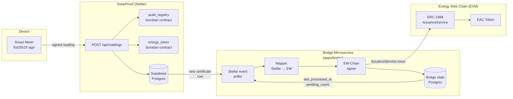

# I-REC / Energy Web Interoperability — Architecture & Operations

> Research for SolarProof — Level 3 roadmap item (see README Product Levels)

---

## 1. Context

SolarProof currently mints its own on-chain energy certificates (1 token = 1 kWh) anchored to Stellar. To gain acceptance in established corporate procurement and regulatory markets, SolarProof certificates need to be **bridged to or recognised by**:

- **I-REC(E)** — the International Renewable Energy Certificate standard, administered by I-TRACK Foundation / Evident registry (used in 50+ countries)
- **Energy Web Origin** — an open-source SDK + EW-Chain marketplace for Energy Attribute Certificates (EACs)

This document covers the technical requirements for interoperability, the bridge microservice architecture, the failover procedure, and monitoring.

---

## 2. Bridge Architecture

### 2.1 System overview

The bridge microservice (`apps/bridge`) watches for new SolarProof certificates on Stellar and issues corresponding ERC-1888 EAC tokens on Energy Web Chain (EW-Chain). It runs as a standalone Node.js process alongside the main web application.



### 2.2 Bridge microservice internals

The bridge is an event-driven polling loop. On each tick it:

1. Queries Supabase for `certificates` rows where `ew_token_id IS NULL AND created_at > last_processed_at`.
2. Maps each SolarProof certificate to an `EACIssuanceRequest`.
3. Calls `IssuanceService.issue()` on EW-Chain via ethers.js.
4. On success, writes the returned ERC-1888 token ID back to `certificates.ew_token_id` and advances `last_processed_at`.
5. On failure, increments a `bridge_retry_count` column and logs the error; the row is retried on the next tick up to `MAX_RETRIES` (default 5).

Key environment variables:

| Variable | Description |
|---|---|
| `EW_RPC_URL` | EW-Chain JSON-RPC endpoint |
| `EW_ISSUER_PRIVATE_KEY` | Issuer key authorised in EW Origin (store in Vault / GitHub Secret) |
| `EW_DEVICE_REGISTRY_CONTRACT` | On-chain address of the EW Origin Device Registry |
| `EW_ISSUANCE_CONTRACT` | On-chain address of `IssuanceService` |
| `BRIDGE_POLL_INTERVAL_MS` | Polling interval (default `15000` ms) |
| `BRIDGE_MAX_RETRIES` | Max retry attempts per certificate (default `5`) |
| `DATABASE_URL` | Supabase connection string (same as web app) |

---

## 3. Expected Latency

| Step | Typical duration |
|---|---|
| Meter reading → SolarProof certificate issued | < 30 s (Stellar finality ~5–10 s + mint job) |
| Certificate row visible to bridge poller | ≤ `BRIDGE_POLL_INTERVAL_MS` (default 15 s) |
| EW-Chain transaction confirmation | 15–60 s (EW-Chain PoA block time ~5 s, 3 confirmations) |
| **Total: SolarProof certificate → ERC-1888 token** | **< 2 minutes under normal conditions** |

Latency above 5 minutes for a single certificate should be treated as anomalous and investigated.

---

## 4. Monitoring Metrics

The bridge exposes the following observable signals. Collect them via your metrics pipeline (e.g., Prometheus scrape, Datadog agent, or CloudWatch).

| Metric | Type | Description |
|---|---|---|
| `bridge_pending_events` | Gauge | Certificates in Supabase with `ew_token_id IS NULL` and `bridge_retry_count < MAX_RETRIES` |
| `bridge_last_processed_at` | Gauge (Unix ms) | Timestamp of the most recently successfully bridged certificate |
| `bridge_issues_total` | Counter | Total ERC-1888 tokens successfully issued |
| `bridge_errors_total` | Counter | Total issuance failures (by error type label) |
| `bridge_retry_queue_depth` | Gauge | Certificates currently in retry backoff |

**Alert thresholds (suggested):**

- `bridge_pending_events > 10` for more than 5 minutes → P3 alert.
- `bridge_last_processed_at` older than 10 minutes → P2 alert (bridge may be stalled).
- `bridge_errors_total` rate > 1/min over 5 minutes → P3 alert.

Check bridge health from the command line:

```bash
# Count certificates not yet bridged
psql $DATABASE_URL -c "
  SELECT count(*) AS pending
  FROM certificates
  WHERE ew_token_id IS NULL
    AND bridge_retry_count < 5;"

# Most recently bridged certificate
psql $DATABASE_URL -c "
  SELECT max(ew_bridged_at) AS last_processed_at
  FROM certificates
  WHERE ew_token_id IS NOT NULL;"
```

---

## 5. Failover Procedure

Use this procedure when EW-Chain is unavailable, the bridge is stalled, or you need to perform maintenance.

### 5.1 Pause the bridge

Stop the bridge process to prevent further issuance attempts (which would pile up retries and log noise):

```bash
# If running via Docker Compose or a process manager:
docker compose stop bridge

# If deployed as a systemd service:
systemctl stop solarproof-bridge

# If deployed on Render / Railway / Fly.io:
# Scale the bridge service to 0 instances via the platform dashboard.
```

SolarProof certificate issuance on Stellar is **not affected** — the web app continues to anchor and mint tokens on Stellar independently of the bridge.

### 5.2 Confirm pending queue depth

```bash
psql $DATABASE_URL -c "
  SELECT count(*) AS stuck,
         min(created_at) AS oldest
  FROM certificates
  WHERE ew_token_id IS NULL;"
```

### 5.3 Wait for EW-Chain recovery

Monitor EW-Chain status:
- EW-Chain explorer: https://explorer.energyweb.org
- EW-Chain status: https://status.energyweb.org

### 5.4 Reset retry counters before resuming

After EW-Chain recovers, reset any certificates that exhausted their retry budget so the bridge will process them on the next tick:

```bash
psql $DATABASE_URL -c "
  UPDATE certificates
  SET bridge_retry_count = 0
  WHERE ew_token_id IS NULL
    AND bridge_retry_count >= 5;"
```

### 5.5 Resume the bridge

```bash
docker compose start bridge
# or
systemctl start solarproof-bridge
```

Watch the logs to confirm processing resumes:

```bash
docker compose logs -f bridge
# Expected: INFO  Bridging certificate <id> → EW token <token_id>
```

Confirm the queue drains:

```bash
watch -n 10 'psql $DATABASE_URL -tAc "
  SELECT count(*) FROM certificates WHERE ew_token_id IS NULL;"'
```

### 5.6 Replay a specific certificate manually

If a single certificate is stuck and you need to force-replay it immediately:

```bash
# Reset just that certificate's retry count
psql $DATABASE_URL -c "
  UPDATE certificates
  SET bridge_retry_count = 0
  WHERE id = '<certificate-uuid>';"

# The bridge will pick it up on the next poll tick.
```

---

## 6. I-REC(E) Interoperability

### 6.1 How I-REC works

1. A **production device** (solar plant, wind farm) is registered with an accredited **Issuer** in its country.
2. The Issuer verifies meter data and issues I-REC(E) certificates in the **Evident registry** (1 I-REC = 1 MWh).
3. Certificates are transferred to buyers and **redeemed** (retired) against a specific time period and beneficiary.
4. Each I-REC carries: unique ID, device ID, country, energy source, production period (start/end), volume (MWh), issuance date, issuer.

### 6.2 Technical integration path

| Step | Requirement | SolarProof gap |
|------|-------------|---------------|
| Device registration | Register each cooperative's solar installation with an accredited I-REC Issuer; provide device capacity, location, technology, commissioning date | Need device registry with lat/lon, capacity (kW), tech type fields |
| MRV data submission | Submit independently-verified meter readings to Issuer (PDF or API); readings must be MWh-granularity (not kWh) | SolarProof readings are kWh — need aggregation to MWh before submission |
| Certificate issuance | Issuer calls Evident API to mint I-RECs; SolarProof cannot mint I-RECs directly | Bridge role: SolarProof acts as MRV data provider, Issuer mints I-RECs |
| API integration | Evident supports REST API for registered users (account, devices, certificates, transfers, redemptions) | Need Evident API credentials + OAuth; map SolarProof `certificates` to Evident payload |
| Redemption | Buyer redeems via Evident registry; SolarProof on-chain retirement must be linked to Evident redemption ID | Add `irec_redemption_id` field to `certificates` table |

### 6.3 Required data fields (I-REC device registration)

```
deviceId         string   unique identifier in SolarProof
country          string   ISO 3166-1 alpha-2
fuelType         string   "Solar" | "Wind" | "Hydro" | ...
technology       string   e.g. "Photovoltaic"
capacity         number   installed capacity in kW
commissionDate   date     YYYY-MM-DD
location         object   { lat, lon, address }
registrantId     string   Evident account ID of the cooperative
```

### 6.4 Key gap: granularity

I-REC issues per **MWh**. SolarProof meters report per **reading** (sub-kWh precision). The bridge must aggregate readings into monthly MWh batches before submitting to Evident.

### 6.5 Key gap: cryptographic proof not required by I-REC

I-REC does not currently require or validate cryptographic proofs (Ed25519 signatures). SolarProof's signed readings are **additional assurance** but cannot be submitted to Evident in lieu of the standard MRV process. This is SolarProof's differentiator: the cryptographic anchor proves to buyers that the MRV data was not tampered with between meter and Issuer.

---

## 7. Energy Web Origin — ERC-1888 Integration Details

### 7.1 How Energy Web Origin works

- Built on **Energy Web Chain (EW-Chain)** — a Proof-of-Authority EVM chain purpose-built for energy.
- Core component: **Traceability SDK** — issues EACs as ERC-1888 tokens (fractional certificates).
- Each EAC token carries: device ID, energy source, generation start/end, volume (Wh), issuer address.

### 7.2 ERC-1888 EAC data schema

```typescript
interface EACIssuanceRequest {
  deviceId: string           // registered EW Origin device
  generationStartTime: number  // Unix timestamp
  generationEndTime: number    // Unix timestamp
  energy: number             // Wh
  metadata?: string          // JSON string — embeds SolarProof anchor tx hash
}
```

The bridge sets `metadata` to a JSON string containing the SolarProof certificate ID and Stellar anchor transaction hash, providing a verifiable link between the two chains.

### 7.3 Key gap: dual-chain architecture

SolarProof is Stellar-native. Energy Web Origin is EVM-native (EW-Chain). The bridge requires:
- A service account with EW-Chain gas (EWT tokens)
- A signing key authorised by an EW Origin Issuer
- A mapping layer from Stellar `energy_token` → ERC-1888 EAC

---

## 8. Comparison: I-REC vs Energy Web for SolarProof

| Dimension | I-REC(E) | Energy Web Origin |
|-----------|----------|-------------------|
| Market reach | 50+ countries, dominant corporate procurement standard | Primarily EU / Energy Web ecosystem |
| Token standard | Off-chain registry (Evident) | ERC-1888 on EW-Chain |
| Crypto-native | No — registry is centralised | Yes — on-chain tokens |
| MRV granularity | MWh (monthly batches) | Wh (high-granularity) |
| Integration complexity | Medium — REST API to Evident | High — EVM bridge required |
| Cryptographic proof support | None natively | Metadata field (extensible) |
| Priority for SolarProof | **High** — needed for corporate buyers | Medium — relevant for EW ecosystem |

---

## 9. Recommended implementation approach

### Phase 1: I-REC bridge (Priority: High)

1. Add `irec_device_id`, `irec_redemption_id` columns to `meters` and `certificates` tables.
2. Build a `POST /api/irec/submit-batch` endpoint that aggregates readings by device/month into MWh, formats the Evident API payload, and calls Evident to request issuance.
3. On successful I-REC issuance, store the `irec_certificate_id` on the SolarProof certificate record.
4. Surface the I-REC ID on the public verifier page (`/verify`) so buyers can cross-reference.

### Phase 2: Energy Web bridge (Priority: Medium)

Deploy the `apps/bridge` microservice (see Section 2). Follow the failover procedure in Section 5 for operational continuity.

### Phase 3: Cryptographic proof as differentiator (Future)

- Advocate with I-TRACK Foundation to add optional cryptographic proof fields to the I-REC(E) standard.
- SolarProof's Ed25519 anchored readings are well-positioned as a reference implementation for tamper-evident MRV.

---

## 10. Open questions

1. **Evident API access** — requires registering SolarProof (or cooperatives) as Evident users. Who is the legal Registrant entity?
2. **Accredited Issuer** — SolarProof cannot issue I-RECs itself; it must work with an accredited Issuer in each country. Which Issuer partner(s) to approach first?
3. **MRV independence** — I-REC requires meter data to be "independently verified." Does the Ed25519 signature + Stellar anchor satisfy Issuers as MRV evidence, or is a third-party inspection still required?
4. **EWT gas** — for EW-Chain integration, who funds the EWT gas account?
5. **Token retirement coordination** — if a certificate is retired on both SolarProof (Stellar) and I-REC (Evident), how is double-counting prevented?

---

## 11. References

- I-TRACK Foundation — International Attribute Tracking Standard: https://www.trackingstandard.org/the-standard/
- I-REC(E) Product Code (Evident): https://www.trackingstandard.org/product-code/electricity/
- Guidance for API Integration with Evident Registry: https://www.trackingstandard.org/guidance-for-api-integration-with-evident-registry-for-i-rece/
- Energy Web Origin documentation: https://energy-web-foundation-origin.readthedocs-hosted.com/
- EW Origin GitHub (Traceability SDK): https://github.com/energywebfoundation/origin
- EW-Chain explorer: https://explorer.energyweb.org
- Bridge microservice: `apps/bridge/`


---
