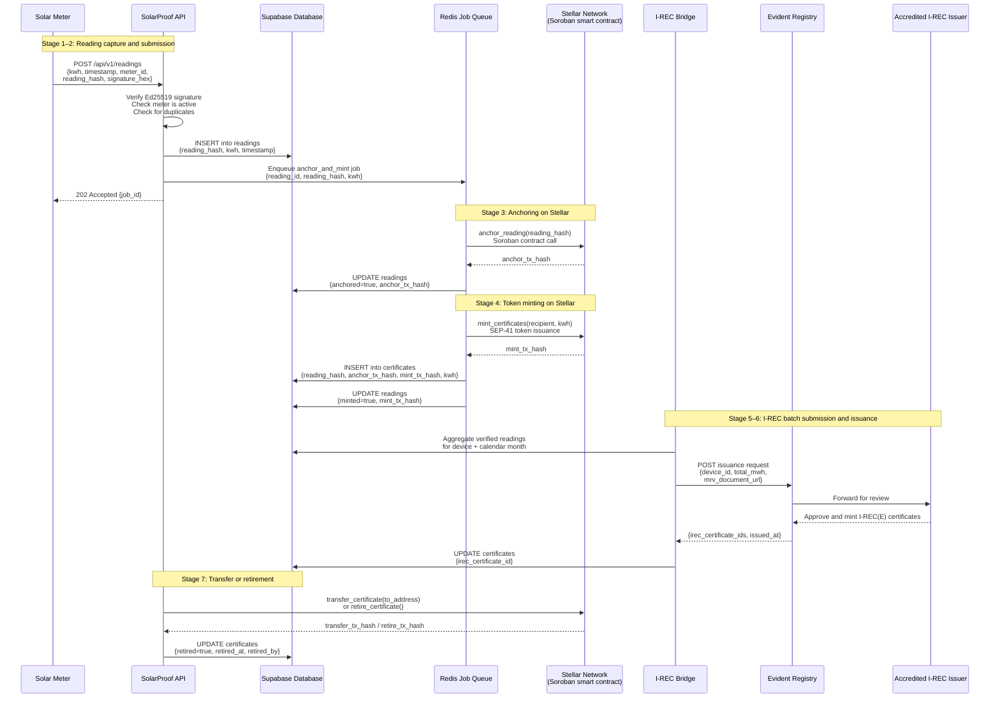

# I-REC Integration Guide

This document has two parts:

- **Part 1 — Certificate Lifecycle (Auditor Guide):** A plain-English explanation of how a physical kWh reading becomes an I-REC certificate. For non-technical auditors, certificate buyers, and regulatory reviewers.
- **Part 2 — Bridge Integration Guide (Operator How-To):** Step-by-step instructions for cooperative operators to register devices and submit monthly batches to Evident.

---

# Part 1 — I-REC Certificate Lifecycle (Auditor Guide)

> **Audience:** Non-technical auditors, certificate buyers, and regulatory reviewers who need to understand how a physical solar energy reading becomes a verifiable I-REC certificate on SolarProof. No coding knowledge is assumed.
>
> **Related technical docs:** [IREC_ENERGYWEB_INTEROP.md](./IREC_ENERGYWEB_INTEROP.md) (technical research)

---

## What This Document Covers

This guide answers the question: *"How does a physical kilowatt-hour reading from a solar panel turn into a tradeable, retirable I-REC certificate — and how can I verify it?"*

It covers:

1. The plain-English lifecycle from panel to certificate.
2. A sequence diagram showing every system involved.
3. A glossary of key terms.
4. Where and how independent verification is possible at each stage.

---

## The Lifecycle in Plain English

### Stage 1 — A meter records energy generation

A solar installation has a hardware meter attached to it. Every hour (or at a configured interval), the meter measures how much electricity the panels have generated and records it in kilowatt-hours (kWh).

The meter does not simply write a number. It attaches a **cryptographic signature** to every reading — a mathematical fingerprint unique to that reading and that meter. This signature makes it impossible to alter the reading without detection, even by the platform operator.

### Stage 2 — The reading is submitted to SolarProof

The meter (or a gateway device) sends the signed reading to the SolarProof API over an encrypted connection. Before the platform accepts the reading, it checks:

- The signature is valid for the meter's registered key.
- The meter is active and has not been revoked.
- The reading is not a duplicate of one already received.

If any check fails, the reading is rejected and an error is logged. Only readings that pass all checks are stored.

### Stage 3 — The reading is anchored on the Stellar blockchain

Accepted readings are queued for **anchoring**. Anchoring means computing a **reading hash** (a short, unique fingerprint of the reading's data) and writing that hash to the Stellar blockchain inside a smart contract transaction.

Once anchored, the hash is permanent and public. Anyone can retrieve the Stellar transaction and confirm that the hash matches the reading stored in SolarProof's database. The reading's content cannot be altered retroactively without the hash on-chain changing — which is impossible.

This step creates the immutable audit trail that underpins all subsequent certificate claims.

### Stage 4 — An energy token (certificate) is minted on Stellar

After anchoring succeeds, the platform mints an **energy token** on Stellar — a SEP-41 standard token representing the kWh amount of that reading. The token is issued to the cooperative's Stellar account.

Minting is recorded with a second Stellar transaction hash. Both transaction hashes (anchor and mint) are stored on the certificate record and displayed publicly on the `/verify` page.

### Stage 5 — The batch is submitted to the I-REC registry

At the end of each calendar month, the cooperative submits a **batch** of verified readings to the **Evident registry** via the I-REC bridge. The bridge:

1. Adds up all verified, anchored readings for the period to produce a total MWh figure.
2. Constructs a Measurement, Reporting and Verification (MRV) document link — a URL pointing to the SolarProof public verification page covering all readings in the batch.
3. Submits the total MWh and the MRV link to Evident on behalf of the cooperative.

Evident is an accredited I-REC registry operator. It records the submission and passes it to an accredited **I-REC Issuer** in the cooperative's country for review.

### Stage 6 — The I-REC Issuer mints the official certificate

The accredited I-REC Issuer reviews the MRV document and, if satisfied, mints one or more **I-REC(E) certificates** in the Evident registry. Each certificate represents 1 MWh of verified solar generation.

The Evident registry assigns a unique I-REC certificate identifier (e.g. `IREC-GB-2026-09-001`) to each certificate. SolarProof stores this identifier on the corresponding certificate record and displays it on the public verification page.

### Stage 7 — The certificate can be transferred or retired

The certificate holder (the cooperative or a buyer) can:

- **Transfer** the certificate to another party's Stellar address (peer-to-peer sale or donation).
- **Retire** (redeem) the certificate to claim its renewable energy attribute. Retirement is permanent and recorded both on-chain and in the Evident registry.

A retired certificate cannot be transferred or retired again. This prevents double-counting — the central problem in renewable energy certificate markets.

---

## Sequence Diagram

The diagram below shows the full lifecycle with all systems involved and the data passed at each step.



---

## How to Verify a Certificate Independently

Any party can verify a SolarProof certificate without trusting the platform:

1. **Retrieve the certificate details** from `https://solarproof.vercel.app/verify?id=<certificate-id>`. This page shows the reading hash, anchor transaction hash, mint transaction hash, and I-REC certificate ID.

2. **Check the anchor transaction** on the public Stellar blockchain. Paste the `anchor_tx_hash` into a Stellar block explorer (e.g. [Stellar Expert](https://stellar.expert)) and confirm the transaction data contains the `reading_hash`.

3. **Check the mint transaction** using the `mint_tx_hash` on Stellar Expert. Confirm the SEP-41 token issuance matches the kWh amount on the certificate.

4. **Cross-check the I-REC certificate** using the `irec_certificate_id` on the [I-TRACK Evident portal](https://www.trackingstandard.org). Confirm the certificate has not been double-redeemed.

---

## Glossary

| Term | Plain-English definition |
|---|---|
| **reading_hash** | A short, unique fingerprint (SHA-256) computed from a meter reading's data: meter ID, kWh value, and timestamp. If any part of the reading changes, the hash changes. This fingerprint is what gets written to the Stellar blockchain. |
| **Ed25519 signature** | A cryptographic seal attached to each reading by the meter's private key. Only the meter that generated the reading can produce this seal. It proves the reading came from a specific, registered device and was not altered in transit. |
| **anchor** | The act of writing a reading's hash to the Stellar blockchain inside a smart contract. Once anchored, the hash is permanent and public — it cannot be altered or deleted. Anchoring creates the tamper-evident audit trail. |
| **anchor_tx_hash** | The unique identifier of the Stellar blockchain transaction that wrote the reading hash on-chain. Used by auditors to independently verify the anchor on a public block explorer. |
| **mint** | The creation of an energy token on the Stellar blockchain representing the kWh amount of a verified, anchored reading. Minting issues the digital certificate to the cooperative's Stellar account. |
| **mint_tx_hash** | The unique identifier of the Stellar blockchain transaction that created (minted) the energy token. Used by auditors to verify the token issuance on a public block explorer. |
| **SEP-41** | The Stellar Ecosystem Proposal defining the standard interface for fungible tokens on Stellar. SolarProof energy tokens conform to SEP-41, making them compatible with standard Stellar wallets and exchanges. |
| **retirement** | The permanent redemption of a certificate to claim its renewable energy attribute. A retired certificate cannot be transferred or retired again, preventing double-counting. |
| **MRV document** | Measurement, Reporting and Verification document. The I-REC standard requires an MRV document as evidence for each issuance request. SolarProof's MRV document is the public `/verify` page covering all readings in a batch. |
| **Evident** | The registry platform operated by the I-TRACK Foundation for I-REC(E) certificates. Cooperatives register devices and submit issuance requests through Evident. |
| **I-REC(E)** | International Renewable Energy Certificate (Electricity). A market-standard certificate representing 1 MWh of verified electricity generation from a renewable source, issued by an accredited I-REC Issuer through the Evident registry. |
| **accredited I-REC Issuer** | A body approved by the I-TRACK Foundation to mint I-REC(E) certificates in a specific country. SolarProof cannot mint I-RECs directly; the Issuer reviews the MRV document and mints certificates on the cooperative's behalf. |
| **irec_certificate_id** | The unique identifier assigned by the Evident registry to each I-REC(E) certificate (e.g. `IREC-GB-2026-09-001`). Used to look up the certificate on the I-TRACK Evident portal for independent verification. |
| **Soroban** | The smart contract platform built into the Stellar network. SolarProof's `audit_registry` and `energy_token` contracts run on Soroban, making contract execution auditable and deterministic. |
| **cooperative** | An organisation (cooperative, community energy group, or similar) that operates one or more solar installations registered on SolarProof. Each cooperative has an admin Stellar address and manages its own meters and certificates. |

---

## Notes for Auditors

- **Non-technical review note.** This document was written for non-technical stakeholders. For the full technical specification — including API schemas, smart contract interfaces, and Ed25519 protocol details — see [ED25519_PROTOCOL.md](./ED25519_PROTOCOL.md), [CONTRACT_INTERFACE_DOCS.md](./CONTRACT_INTERFACE_DOCS.md), and [API.md](./API.md).
- **Blockchain immutability caveat.** While the Stellar blockchain provides strong tamper-evidence, the security of the full chain depends on the meter's private key remaining secret. If a meter's key is compromised and the meter is not promptly revoked, an attacker could submit fraudulent readings. The meter key revocation procedure is documented in [docs/runbooks/meter-key-rotation.md](./runbooks/meter-key-rotation.md).
- **I-REC Issuer independence.** The accredited I-REC Issuer is an independent third party approved by the I-TRACK Foundation. SolarProof does not control or influence the Issuer's review process. The Issuer reviews the MRV document independently before minting any I-REC certificates.


> **Audience:** Cooperative operators who have deployed the SolarProof I-REC bridge and want to register their devices, submit monthly batches to Evident, and diagnose common API errors.  
> **Background research:** [IREC_ENERGYWEB_INTEROP.md](./IREC_ENERGYWEB_INTEROP.md)  
> **Status:** This guide tracks the bridge implementation. Review it against the running bridge before onboarding new cooperatives.

---

---

# Part 2 — I-REC Bridge Integration Guide (Cooperative Operator)

> **Audience:** Cooperative operators who have deployed the SolarProof I-REC bridge and want to register their devices, submit monthly batches to Evident, and diagnose common API errors.  
> **Background research:** [IREC_ENERGYWEB_INTEROP.md](./IREC_ENERGYWEB_INTEROP.md)  
> **Status:** This guide tracks the bridge implementation. Review it against the running bridge before onboarding new cooperatives.

## Overview

The SolarProof I-REC bridge acts as a **Measurement, Reporting and Verification (MRV) data provider**. It aggregates your SolarProof kWh readings into monthly MWh batches and submits them to the [Evident registry](https://www.trackingstandard.org/product-code/electricity/) via the Evident REST API, where an accredited I-REC Issuer mints the resulting I-REC(E) certificates.

```
SolarProof meters (kWh readings, Ed25519 signed)
        │
        ▼
SolarProof API  (audit_registry anchor on Stellar)
        │
        ▼
I-REC Bridge  (POST /api/irec/submit-batch)
  1. Aggregate readings per device per month → MWh
  2. Upload MRV document URL (SolarProof /verify link)
  3. POST to Evident API → issuance request
        │
        ▼
Evident Registry  (I-REC(E) certificates minted by accredited Issuer)
        │
        ▼
SolarProof certificate record  (irec_certificate_id stored, shown on /verify)
```

---

## Prerequisites

Before using the bridge you must have:

1. **An Evident account** — Register at [evident.energy](https://evident.energy) as a **Registrant** (cooperative entity). This requires submitting legal documentation of your cooperative. Allow 5–10 business days for approval.

2. **An accredited I-REC Issuer** in your country — SolarProof cannot mint I-RECs directly; an accredited Issuer must approve and mint certificates on your behalf. Contact the [I-TRACK Foundation](https://www.trackingstandard.org) for a list of Issuers by country.

3. **Evident API credentials** — Once your Evident account is approved, generate an OAuth client ID and secret from **Evident Portal → Settings → API Access**.

4. **Bridge environment variables** — Set the following in `apps/web/.env.local` (never commit these):

   ```env
   EVIDENT_CLIENT_ID=your-client-id
   EVIDENT_CLIENT_SECRET=your-client-secret
   EVIDENT_API_URL=https://api.evident.energy/v1   # production
   # EVIDENT_API_URL=https://api-sandbox.evident.energy/v1  # sandbox for testing
   EVIDENT_REGISTRANT_ID=your-registrant-account-id
   ```

5. **Device fields in your cooperative record** — Each meter that will have I-RECs issued must have the following fields populated in the `meters` table (via the API or Supabase dashboard):

   | Field | Description | Example |
   |---|---|---|
   | `irec_device_id` | Unique I-REC device identifier (assigned by Evident after device registration) | `DEV-001-GBR` |
   | `country` | ISO 3166-1 alpha-2 country code | `GB` |
   | `fuel_type` | Energy source type | `Solar` |
   | `technology` | Technology sub-type | `Photovoltaic` |
   | `capacity_kw` | Installed capacity in kW | `10.5` |
   | `commission_date` | ISO date of commissioning | `2025-03-01` |
   | `latitude` | Device latitude (decimal degrees) | `51.5074` |
   | `longitude` | Device longitude (decimal degrees) | `-0.1278` |

---

## Step 1 — Register a Device with Evident

Before your first batch submission you must register each solar installation as a **device** in the Evident registry. This is a one-time step per device.

### 1a. Prepare the device registration payload

Collect the required fields from the Prerequisites table above. The `irec_device_id` is assigned by Evident *after* registration — you will store it back on your meter record once received.

### 1b. Call the bridge device registration endpoint

```bash
curl -X POST https://solarproof.vercel.app/api/irec/register-device \
  -H "Authorization: Bearer <your-jwt>" \
  -H "Content-Type: application/json" \
  -d '{
    "meter_id": "<your-meter-uuid>",
    "country": "GB",
    "fuel_type": "Solar",
    "technology": "Photovoltaic",
    "capacity_kw": 10.5,
    "commission_date": "2025-03-01",
    "latitude": 51.5074,
    "longitude": -0.1278
  }'
```

**Expected response (201)**

```json
{
  "irec_device_id": "DEV-001-GBR",
  "status": "pending_issuer_approval"
}
```

The device status will be `pending_issuer_approval` until your accredited Issuer approves it in the Evident portal. You will receive an email confirmation from Evident.

### 1c. Store the returned `irec_device_id`

Once you receive the `irec_device_id`, the bridge stores it automatically on the meter record. You can verify it via:

```bash
curl https://solarproof.vercel.app/api/v1/meters/<meter-uuid> \
  -H "Authorization: Bearer <your-jwt>"
```

Look for `"irec_device_id": "DEV-001-GBR"` in the response.

---

## Step 2 — Trigger a Batch Submission

The bridge aggregates all verified SolarProof readings for a given device and calendar month into a single MWh figure, then submits an issuance request to Evident.

### 2a. Ensure all readings for the month are anchored

Before submitting a batch, confirm that all readings for the target month are in `verified` status (Ed25519 signature confirmed and hash anchored on Stellar). Use the cooperative stats endpoint to check:

```bash
curl "https://solarproof.vercel.app/api/v1/cooperative/stats?granularity=month&date_from=2026-09-01T00:00:00.000Z&date_to=2026-09-30T23:59:59.000Z" \
  -H "Authorization: Bearer <your-jwt>"
```

Confirm `meter_stats[].readings_count` matches your expected reading count for the month.

### 2b. Submit the batch

```bash
curl -X POST https://solarproof.vercel.app/api/irec/submit-batch \
  -H "Authorization: Bearer <your-jwt>" \
  -H "Content-Type: application/json" \
  -d '{
    "meter_id": "<your-meter-uuid>",
    "period_start": "2026-09-01T00:00:00.000Z",
    "period_end": "2026-09-30T23:59:59.000Z"
  }'
```

The bridge will:

1. Aggregate all verified readings for the device in the given period into total MWh (`total_kwh / 1000`).
2. Construct the MRV document URL (a SolarProof `/verify` link covering the period).
3. POST the issuance request to Evident.
4. Store the returned `irec_request_id` on the SolarProof certificate records.

**Expected response (202 Accepted)**

```json
{
  "irec_request_id": "IREQ-2026-09-GBR-001",
  "total_mwh": 4.21,
  "readings_included": 168,
  "period_start": "2026-09-01T00:00:00.000Z",
  "period_end": "2026-09-30T23:59:59.000Z",
  "mrv_document_url": "https://solarproof.vercel.app/verify?batch=..."
}
```

### 2c. Monitor issuance status

Evident typically processes issuance requests within 1–3 business days. Poll the status:

```bash
curl "https://solarproof.vercel.app/api/irec/batch-status?request_id=IREQ-2026-09-GBR-001" \
  -H "Authorization: Bearer <your-jwt>"
```

**Response**

```json
{
  "irec_request_id": "IREQ-2026-09-GBR-001",
  "status": "issued",
  "irec_certificate_ids": ["IREC-GB-2026-09-001", "IREC-GB-2026-09-002"],
  "issued_at": "2026-10-02T14:00:00.000Z"
}
```

Possible statuses: `pending` · `processing` · `issued` · `rejected`

Once `issued`, the `irec_certificate_ids` are stored on the SolarProof certificates and displayed on the public `/verify` page.

---

## Step 3 — Verify the Cross-Reference

After issuance, buyers can independently verify the link between a SolarProof certificate and its I-REC:

1. Navigate to `https://solarproof.vercel.app/verify?id=<cert-id>`.
2. Scroll to the **I-REC** section — it shows the `irec_certificate_id` and a direct link to the Evident registry entry.
3. Buyers can cross-check the Evident ID on the [I-TRACK Evident portal](https://www.trackingstandard.org) to confirm the I-REC was not double-redeemed.

---

## Troubleshooting — Common Evident API Errors

| HTTP Status | Evident error code | Cause | Resolution |
|---|---|---|---|
| `400 Bad Request` | `DEVICE_NOT_FOUND` | The `irec_device_id` does not exist in Evident | Verify the device ID with `GET /api/irec/device-status?meter_id=<uuid>`. Re-register if missing. |
| `400 Bad Request` | `INVALID_PERIOD` | `period_start` or `period_end` is malformed or the period exceeds one calendar month | Use ISO 8601 datetimes. Ensure `period_end` is at most the last instant of the same month as `period_start`. |
| `400 Bad Request` | `VOLUME_BELOW_MINIMUM` | Total MWh for the period is less than 0.001 MWh (1 kWh) | Aggregate more readings before submitting. I-REC(E) certificates are issued in whole MWh; sub-MWh volumes are rounded down. |
| `401 Unauthorized` | `INVALID_TOKEN` | OAuth access token expired or revoked | The bridge auto-refreshes tokens; if this persists, check `EVIDENT_CLIENT_ID` and `EVIDENT_CLIENT_SECRET` are current. |
| `403 Forbidden` | `DEVICE_PENDING_APPROVAL` | The device is registered but not yet approved by the Issuer | Contact your accredited Issuer and ask them to approve the device in the Evident portal. |
| `403 Forbidden` | `REGISTRANT_SUSPENDED` | Your Evident registrant account is suspended | Contact Evident support at [support@evident.energy](mailto:support@evident.energy). |
| `409 Conflict` | `DUPLICATE_SUBMISSION` | A batch for this device + period was already submitted | Retrieve the existing request ID via `GET /api/irec/batch-status?meter_id=<uuid>&period=2026-09`. Do not resubmit. |
| `422 Unprocessable Entity` | `MRV_DOCUMENT_UNREACHABLE` | Evident cannot reach the MRV document URL | Ensure `https://solarproof.vercel.app/verify?batch=...` is publicly accessible. Check Vercel deployment status. |
| `429 Too Many Requests` | `RATE_LIMIT_EXCEEDED` | More than 60 API calls per minute to Evident | The bridge applies exponential back-off automatically. If you see this in logs, check for runaway batch jobs. |
| `500 Internal Server Error` | `EVIDENT_INTERNAL_ERROR` | Transient Evident platform error | Retry after 15 minutes. If the error persists beyond 1 hour, contact Evident support with the `X-Request-Id` from the response header. |

### Bridge-side errors (not Evident API)

| Error message | Cause | Resolution |
|---|---|---|
| `"No verified readings found for period"` | No readings in the requested period have `anchor_tx_hash` set | Confirm readings were anchored on Stellar. Check `GET /api/v1/cooperative/stats` for the period. |
| `"irec_device_id not set on meter"` | Device not yet registered with Evident | Complete Step 1 above. |
| `"EVIDENT_CLIENT_ID not configured"` | Bridge env vars missing | Set `EVIDENT_CLIENT_ID` and `EVIDENT_CLIENT_SECRET` in your environment. |
| `"Batch already submitted for this period"` | Idempotency guard triggered | Retrieve the existing request with `GET /api/irec/batch-status`. Do not resubmit. |

---

## Granularity note

I-REC(E) certificates are issued per **MWh**. SolarProof meters report per reading (sub-kWh precision). The bridge automatically:

1. Aggregates all `verified` readings for the device + period into a total kWh figure.
2. Converts to MWh (`total_kwh / 1000`), rounded to 3 decimal places.
3. Reports this as the `volume` in the Evident issuance request.

If your cooperative's monthly generation is under 1 MWh, the bridge will submit a fractional MWh. Some Issuers round down to the nearest whole MWh — check with your Issuer's policy.

---

## References

- [IREC_ENERGYWEB_INTEROP.md](./IREC_ENERGYWEB_INTEROP.md) — technical research and gap analysis
- [API.md](./API.md) — SolarProof v1 API reference
- [Evident API Integration Guidance](https://www.trackingstandard.org/guidance-for-api-integration-with-evident-registry-for-i-rece/)
- [I-REC(E) Product Code](https://www.trackingstandard.org/product-code/electricity/)
- [I-TRACK Foundation](https://www.trackingstandard.org/the-standard/)
